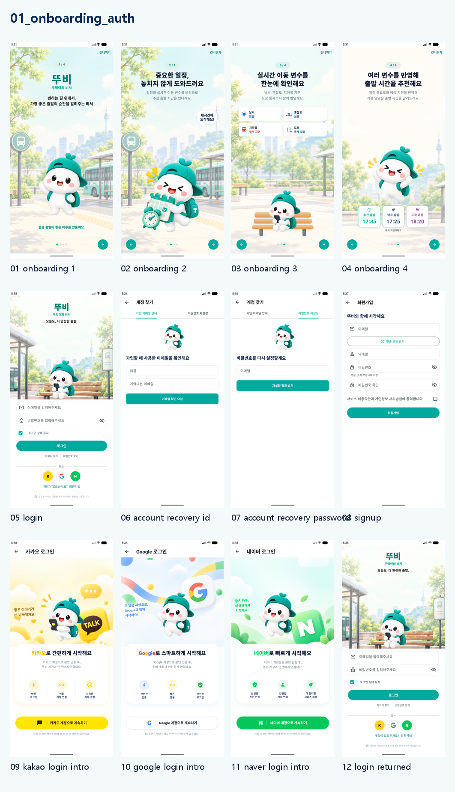
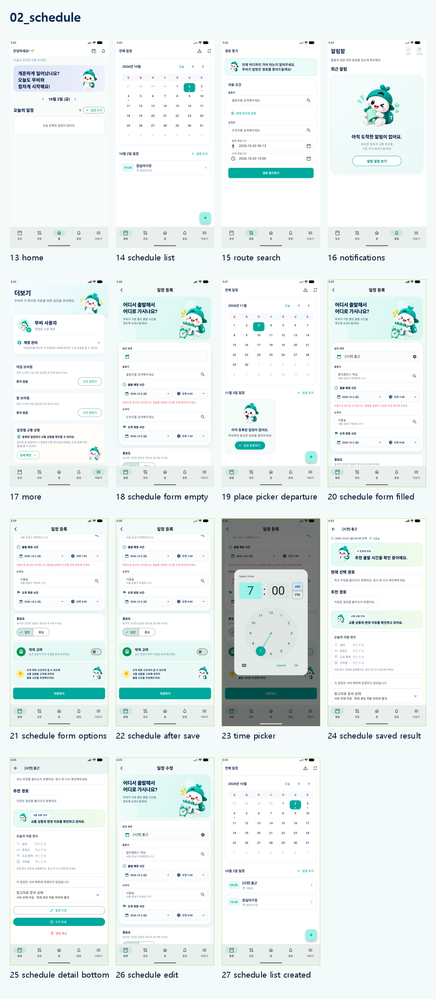
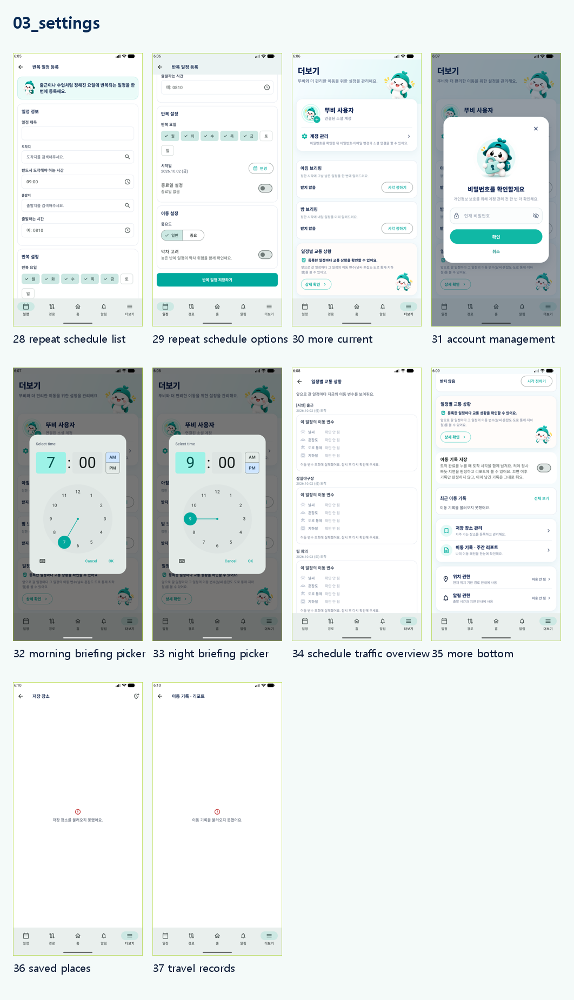
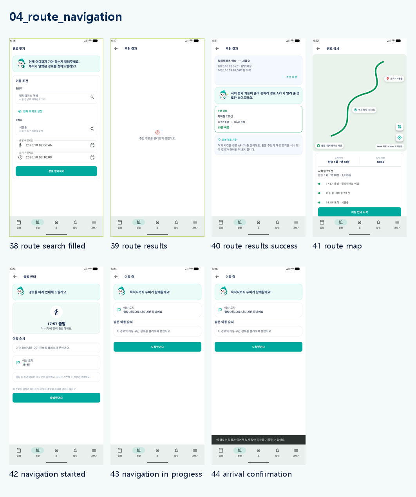

# DDUBI

뚜비는 실시간 교통·날씨·행사 데이터를 분석해 일정에 맞는 출발 시각과 경로를 추천하는 서비스입니다.

## 확정 언어

| 영역 | 언어·기술 |
| --- | --- |
| Collector | Python |
| Archiver | Python |
| Spark Streaming | PySpark |
| Spark Batch | PySpark |
| Backend | Java · Spring Boot |
| Notification | Java · Spring Boot |
| Android · Web | Flutter · Dart |

## 디렉터리

```text
infra/        Docker Compose, Nginx, Kafka, Spark, HDFS, Monitoring
collector/    외부 API 수집 후 Kafka 발행
archiver/     Kafka 원본을 Parquet으로 변환해 HDFS 보관
sparkjobs/    PySpark Streaming·Batch 작업
backend/      사용자·일정·추천 API
notification/ Kafka 알림 이벤트 소비 및 FCM 발송
client/       Flutter Android·Web 공통 클라이언트
docs/         아키텍처와 데이터 계약 / TIL 파일 모음
```

## 데이터 흐름

```text
공공 API → Collector → Kafka ─→ PySpark → Redis
                            └→ Archiver → Parquet → HDFS

Flutter Android/Web → Nginx → Spring Boot → MySQL / Redis
                                      └→ Kafka → Notification → FCM
```

## 화면

Android 에뮬레이터(Galaxy S10, 1440×3040) 기준 전체 화면 캡처입니다. 개별 화면 44장은 [docs/screenshots](docs/screenshots/README.md)에 있습니다.

### 온보딩 · 로그인



### 일정



### 반복 일정 · 더보기 · 설정



### 경로 · 안내



## 현재 상태

이 커밋 전 구조는 팀 검토를 위한 초기 스캐폴드입니다.

- 실제 비밀 값은 커밋하지 않습니다.
- `infra/.env.example`을 복사해 로컬 `.env`를 만듭니다.
- Backend와 Notification은 Spring Initializr 설정 확정 후 생성합니다.
- Client는 Flutter 버전 확정 후 `client/`에서 생성합니다.
- Docker 이미지 버전은 팀 개발 환경 검증 후 고정합니다.
