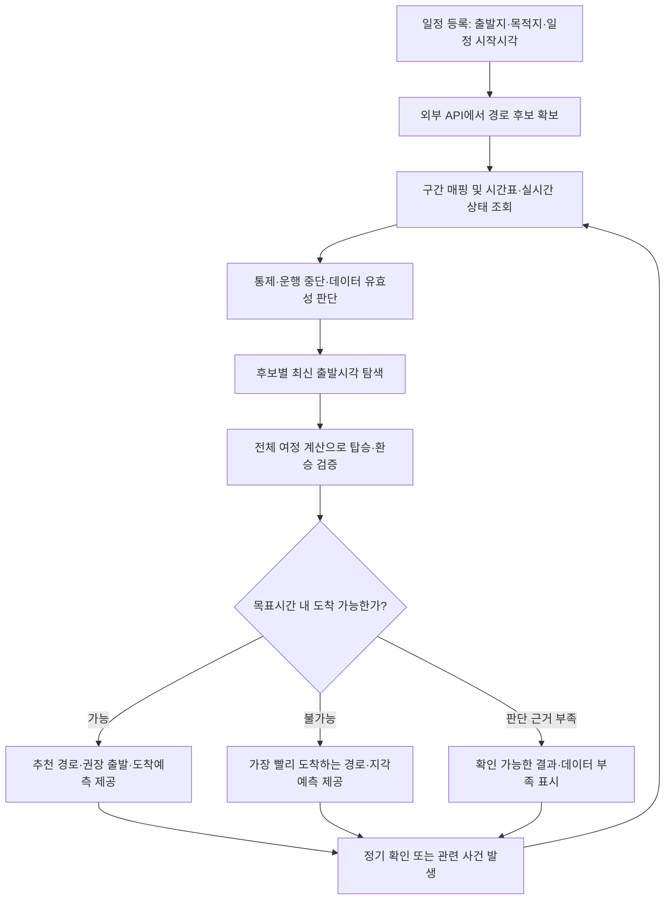

# 일정 시작시각 기반 경로 계산 — 목표 흐름과 예외 처리

- 기록일: 2026-09-16.
- 근거: 사용자가 제시한 일정 등록·재계산·원인 알림 요구사항과 이어진 최종 계산 흐름 설명.
- 상태: **구현 전 설계 기록. 현재 실행 코드·API·DB·배포가 이 설계로 변경되었다는 뜻이 아니다.**
- 현재 코드 확인 기준: `b994af1`과 당시 작업 트리. 미커밋 구현은 배포 완료 항목으로 간주하지 않는다.
- 파일별 변경 계획: [일정 시작시각 기반 계산 적용 계획](arrival-deadline-implementation-plan.md).
- 기존 구현 설명: [일정 재평가](schedule-reevaluation.md), [이동시간 계산](travel-time-calculation.md), [대기시간](transit-waiting.md), [지하철 계산](subway-timing.md), [도로 영향](road-impact.md).

## 1. 요구사항과 제안의 구분

### 1.1 사용자가 명시한 방향

1. 사용자는 일정 시작시각을 입력한다. 출발시각은 시스템이 계산한다.
2. 일정 등록 순간 최초 계산을 시작한다.
3. 일정 시작 1시간 전 다시 계산하고, 30분 전까지 10분 간격, 30분 전부터 5분 간격, 10분 전부터 1분 간격으로 계산한다.
4. 이용 경로에 도로 통제나 지연이 있다면 원인을 알린다.
5. 단순히 지각분을 기존 출발시각에서 빼는 대신, 목표시간 내 도착할 수 있는 출발시각을 계산한다.
6. 통제·지연 발생 시 탑승·환승을 포함한 전체 여정을 다시 평가한다.

### 1.2 구현 방향으로 제안했지만 세부 확정이 필요한 항목

| 항목 | 제안과 미확정 범위 |
|---|---|
| 집중 감시 기준시각 | 시스템이 계산한 권장 출발시각을 기준으로 주기를 운영하는 방안을 권장했다. 사용자가 출발시각을 입력하지 않는다는 답변은 이 기준 변경까지 승인한 것으로 해석하지 않는다. 일정 시작 기준을 유지하더라도 장거리 일정의 출발 전 확인이 필요하다. |
| 탐색 범위·해상도·예산 | 실제 운행 후보 탐색과 제한된 시간 격자 탐색을 사용한다. 최대 범위·1분 해상도·계산 횟수는 운영 성능과 정확도 검증 후 정한다. |
| 중요도별 여유 | 검증된 기준선·예측 오차·분위수 정책을 적용한다. 임의 고정 여유나 검증되지 않은 성공확률을 확정하지 않는다. |
| 추천 순위 | 이용 가능성과 데이터 품질을 먼저 보고, 최신 출발·환승·도보·조기 도착 선호를 비교한다. 항목 간 구체적인 우선순위는 제품 정책으로 확정한다. |
| 알림 임계값 | 의미 있는 시각 변경, 경로 변경, 정시 가능 여부 전환, 확인된 통제·해제를 알린다. 분 단위 임계값과 재알림 간격은 별도 정책이다. |
| 선택 경로 변경 | 시스템의 최신 추천과 사용자가 선택한 경로를 구분한다. 추천 갱신을 사용자 선택 변경으로 자동 처리할지는 별도 결정이다. |
| 이동 중 재탐색 | 현재 위치·탑승 상태·동의·최신성 관리가 필요한 별도 흐름이다. 출발 확인만으로 위치나 탑승 차량을 추측하지 않는다. |

이 문서에 기록했다는 이유로 위 제안이 운영 정책으로 확정되거나 PREVIEW 제한이 해제되는 것은 아니다.

## 2. 전체 흐름



후보가 만료됐거나 통제·운행 변경으로 무효가 됐거나 대안이 부족하면 재계산 과정에서 외부 경로 후보를 다시 요청한다. 매분 평가마다 외부 길찾기 API를 무조건 호출하지 않는다.

## 3. 입력·출력·시간 의미

| 구분 | 값 |
|---|---|
| 사용자 입력 | 출발지, 목적지, 일정 시작시각, 일정 중요도 |
| 계산 결과 | 추천 경로, 권장 출발시각, 예상 도착시각, 소요시간, 정보 부족·잠정 여부, 근거 |
| 내부 관리 | 계산 기준시각, 입력 버전, 다음 확인시각, 데이터·시간표·모델·정책 버전, 사건 버전, 결과 유효기간 |
| 실제 이동 상태 | 실제 출발시각, 확인 가능한 현재 위치·탑승 상태, 도착 상태 |

- `D`: 일정 시작시각. 기본 도착 목표는 `D`다. 별도 사전 도착 정책을 채택하기 전에는 임의로 10분 등을 빼지 않는다.
- `asOf`: 한 평가가 사용할 정보의 기준시각. 당시 확보할 수 없었던 정보를 Replay에 섞지 않는다.
- `d`: 탐색 중인 출발시각. 실행 가능한 권고에서는 `d >= asOf`를 만족해야 한다.
- `t_i`: i번째 구성요소 진입 예상시각. 앞선 도보·대기·탑승·환승 결과로 계산한다.
- 내부 기간은 초, 날짜·운행일 해석은 Asia/Seoul을 기준으로 한다. 기존 API의 LocalDateTime과 절대시각 응답은 경계에서 명시적으로 변환한다.
- 권장 출발, 사용자가 채택한 계획, 실제 출발을 같은 값으로 덮어쓰지 않는다.

## 4. 단계별 계산

### 4.1 등록 직후 평가 작업 등록

일정 저장과 평가 작업 등록을 하나의 DB 트랜잭션에서 보장하고, 커밋 후 즉시 실행을 깨운다. DB에 남은 작업은 서버 재시작 후에도 회수할 수 있어야 한다. 메모리 이벤트만 발행하고 작업을 잃는 구조는 피한다.

화면은 계산 중 상태를 보여준 뒤 결과를 조회한다. 외부 경로·Redis·모델 응답을 기다리는 동안 일정 저장 트랜잭션을 유지하지 않는다. 반복 일정 인스턴스 생성과 일정 수정에도 같은 규칙을 적용한다.

### 4.2 후보 경로 확보

외부 길찾기 API가 후보를 생성한다. DDUBI는 반환된 후보의 노선·승하차지·구간 순서를 기준으로 시간과 이용 가능성을 재평가한다. 전체 교통망의 모든 최단경로를 자체 탐색한다는 의미가 아니다.

예시 후보:

```text
A: 도보 → 버스 → 도보
B: 도보 → 지하철 → 환승 도보 → 지하철 → 도보
C: 도보 → 버스 → 환승 도보 → 지하철 → 도보
```

### 4.3 고정된 계산 증거 확보

후보 구간을 검증된 내부 ID에 연결한 뒤 버스 도착·구간 예측, 지하철 시간표·운행 정보, 도보·환승 시간, 통제 사건, 기준선·최신성·매핑 품질을 조회한다.

한 번의 출발시각 탐색에서는 같은 입력 자료와 버전을 사용한다. 조회 원본뿐 아니라 결측·실패도 기록하여 후보마다 데이터 조건이 달라지거나 같은 장애 요청이 반복되지 않도록 한다.

고정해야 하는 것은 원본 증거와 모델·정책 버전이다. 출발시각이 바뀌면 구간 진입시간에 맞춰 차량 선택과 시간대별 예측을 다시 계산한다. 한 출발에서 구한 대기·이동시간을 모든 출발 후보에 그대로 복사하지 않는다.

자료가 없거나 오래됐으면 명시된 구간별 대체값을 사용하고 신뢰도를 낮춘다. 대체값도 없으면 정보 부족으로 남긴다. 알려진 운행 중단을 평시 시간표 fallback으로 숨기지 않는다.

### 4.4 이용 가능성 판정

```text
같은 실제 구간인가?
→ 같은 방향·이동수단에 적용되는가?
→ 예상 통과시간과 사건 적용시간이 겹치는가?
→ 근거의 최신성·확실성이 충분한가?
```

| 판정 | 처리 |
|---|---|
| 해당 이동수단에 적용되는 완전 통제·운행 중단 확인 | 그 구간을 해당 시간에 이용하는 후보 제외 |
| 부분 통제·지연 가능성 | 영향 근거 표시. 관측·검증된 예측이 있을 때 시간을 재계산 |
| 방향·시간이 확실하게 불일치 | 해당 사건 영향 없음 |
| 매핑·방향·기간 불명확 | 확인 불가 또는 영향 가능성 |

부분 통제만으로 임의 지연 분을 더하지 않는다. 이미 실시간 시간 예측에 반영된 혼잡을 다시 가산하지 않는다. 공식 버스 우회가 확인되면 기존 구간열을 그대로 사용할 수 있는지 재검토하고 외부 대체 후보를 확보한다. 기존 후보 무효를 노선 전체 영구 이용 불가로 확대하지 않는다.

사전 판정 후에도 출발 탐색에서 구한 실제 구간 통과시간으로 다시 검사한다. 경로가 지연되면 뒤 구간의 사건 시간 겹침도 달라질 수 있다.

### 4.5 공통 전체 여정 계산

```text
입력: 경로 후보 + 출발시각 + 고정된 계산 증거

접근 도보
→ 정류장·승강장 도착
→ 그 시각에 탑승 가능한 차량 선택
→ 해당 차량의 하차 예상시각
→ 환승 이동
→ 환승 후 탑승 가능한 차량 선택
→ 이탈 도보
→ 목적지 도착

출력: 구간별 진입·이탈시각, 도착예측, 이용 가능 여부, 품질·사건 근거
```

앞 구간의 결과를 다음 구간의 입력으로 사용한다. 지연으로 환승을 놓치면 다음 차량의 대기시간까지 다시 계산한다. 기존 총소요시간에 지연분을 한 번 더하는 것으로 끝내지 않는다.

실제 차량 시각이 없는 구간은 추정 대기임을 표시한다. API 총시간과 분해한 WAIT/RIDE/WALK를 중복 합산하지 않는다. 도보·환승은 현재 합의된 제공자 구간시간을 유지하며 검증되지 않은 추가 보정을 자동 도입하지 않는다.

### 4.6 최신 출발시각 탐색

목표는 조회한 후보·정의한 탐색 범위 안에서 다음 조건을 만족하는 가장 늦은 출발시각을 찾는 것이다.

```text
d >= asOf
arrival(route, d, snapshot, policy) <= D
해당 이용시간에 모든 필수 구간 이용 가능
탑승·환승 조건 충족
```

| 입력 자료 | 탐색 방식 |
|---|---|
| 실제 운행별 시간표 | 도착 가능한 운행 후보에서 탑승·환승·도보를 역산 |
| 정확한 차량 시간표 부족 | 제한된 범위에서 1분 등 명시적 시간 격자로 평가 |
| 고정시간 도보 | 직접 역산 |
| 도착시각 단조성이 검증된 모델 | 이분 탐색을 선택할 수 있음 |

연속적인 시간이라는 이유만으로 이분 탐색이 성립하지 않는다. 출발을 늦춰도 더 일찍 도착하는 예측값이나 시간대 경계가 있으면 단조성 가정을 검증해야 한다. 거친 탐색만으로 좁은 탑승 가능 구간을 놓치고 최신 출발을 찾았다고 하지 않는다.

탐색 중 외부 길찾기 API를 반복 호출하지 않는다. 증거·입력별 예측을 캐시하고 평가 횟수·실행시간을 제한한다. 예산이 소진되면 탐색 미완료로 표시하며, 모든 경로가 불가능하다고 단정하지 않는다.

역산한 시각도 전체 여정 계산으로 정방향 검증한다. 조회하지 않은 후보까지 포함한 전역 최적이나 실제 정시 도착 보장을 주장하지 않는다.

합성 예시: 일정 09:00, 이탈 도보 5분이면 열차는 08:55까지 도착해야 한다. 08:52 도착 열차를 타기 위한 출발 후보가 08:20이면 전체 도착은 08:57이다. 다른 열차·경로도 비교한 뒤 권장 출발을 선택한다.

### 4.7 결과 선택

| 결과 | 사용자 안내 |
|---|---|
| 목표시간 내 도착 가능한 후보 있음 | 추천 경로·권장 출발·도착예측·소요시간·품질 |
| 평가 가능한 후보가 모두 늦음 | 지금 출발했을 때 가장 빨리 도착하는 후보·도착예측·지각시간 |
| 근거 부족 또는 탐색 미완료 | 확인 가능한 결과와 부족한 정보·미완료 상태 |

이용 불가·정보 부족을 단순한 지각과 구분한다. 이용 가능성과 데이터 품질을 먼저 보고, 정책에 따라 최신 출발·환승·도보·조기 도착 선호를 비교한다.

과거 출발시각은 현재 실행할 수 있는 권고가 아니다. 이를 제공하더라도 현재 정보로 역산한 참고값으로 분리하며, 당시 출발하면 반드시 도착했을 것이라고 표현하지 않는다. 과거 참고 계산은 미래 출발만 평가하는 실행용 계산기와 별도로 다룬다.

## 5. 재계산·수집·실제 출발

### 5.1 사용자가 제시한 일정 기준 주기

일정이 09:00 시작이면 다음과 같다.

| 구간 | 평가 시각 |
|---|---|
| 등록 직후 | 최초 평가 |
| 일정 60~30분 전 | 08:00, 08:10, 08:20, 08:30 |
| 일정 30~10분 전 | 08:35, 08:40, 08:45, 08:50 |
| 일정 10분 전부터 | 08:51부터 매분 |
| 관련 사건 발생 | 정기 주기를 기다리지 않고 평가 작업을 깨움 |

이동에 두 시간이 걸려 07:00 출발이 필요하면 08:00부터 확인하는 것은 늦다. 권장 출발 기준 집중 감시 또는 장거리 일정의 더 이른 감시를 보완해야 한다. 정확한 기준과 두 주기를 함께 둘지는 구현 전 확정할 정책이다.

늦게 등록된 일정은 지난 주기를 모두 재생하지 않고 즉시 최초 계산한다. 새 권장 출발이 당겨지면 다음 확인시각도 조정하고 이미 확인할 시각이 지났으면 즉시 실행한다.

### 5.2 수집과 평가 분리

외부 API는 Collector가 공통 수집하고, 사용자별 평가는 저장된 최신 정보를 읽는다. 사용자마다 동일한 외부 API를 중복 호출하지 않는다. 수집 주기는 제공자 갱신 주기·호출 한도·대상 범위에 맞춰 정한다.

현재 코드 기본 수집 간격은 버스 도착·위치 8시간, 지하철 도착 6분·위치 1시간, 지하철 알림·도로 돌발 15분이다. 이 상태에서 Backend만 매분 계산해도 새 관측이 생기지 않는다. 운영 서버 설정·실제 수집 성공률은 별도 확인 대상이다.

### 5.3 출발 후 전환

출발을 확인하면 출발 전 조기 출발 권고를 중단하고, 현재 위치·탑승 상태가 확보된 경우 남은 여정을 재평가한다. 권장 출발시각이 지났다는 이유만으로 출발했다고 가정하지 않는다.

위치 권한 거절·위치 노후화·오차가 크면 현재 위치를 확정하지 않는다. 일정 수정·취소·도착·경로 이탈에 따라 작업을 갱신하거나 종료한다. 이동 중 감시를 지원할 경우 일정 시작시각 경과만으로 남은 여정 처리를 무조건 중단하지 않도록 상태 규칙을 분리한다.

## 6. 지하철 지연 탐지와 재계산

| 근거 | 판단 |
|---|---|
| 공식 지연·운행 중단 공지 | 공지 대상의 운행 이상 |
| 동일 운행의 계획시각과 실시간 예측 | 그 운행의 시간표 대비 지연 |
| 동일 운행의 연속된 도착예측 | 이전 예측보다 도착이 늦어졌는지 |
| 실시간 결측·노후화 | 확인 불가. 정상 운행으로 간주하지 않음 |

시간표의 운행과 실시간 열차를 연결하려면 운행일·노선·방향·행선지·정차 패턴·열차 대응이 확인되어야 한다. 정적 열차번호를 검증 없이 실시간 ID로 복사하지 않는다.

시간표는 계획된 정차 순서·시각의 기준으로 유지하고, 확보한 열차별·역별 실시간 시각으로 갱신한다. 차량의 시각 보정은 가능하지만 최종 도착시간에 같은 지연을 단순 가산하는 것과 구분한다.

현재 위치·남은 역 수·배차간격만으로 정확한 도착시각이 자동으로 계산되지는 않는다. 남은 구간의 이동·정차시간을 추정할 근거와 불확실성 관리가 필요하다. 운행 중단이 확인됐지만 재개시각을 모르면 도착예측을 확정하지 않고 대안을 찾는다.

설계 참고: [GTFS Realtime Trip Updates](https://gtfs.org/documentation/realtime/feed-entities/trip-updates/)는 운행별 정차시각 변경과 실시간 정보 부재의 의미를 설명한다. 국내 수집 API가 이 표준의 모든 필드를 제공한다는 뜻은 아니다.

## 7. 원인 기록과 알림

계산 근거에는 사건 ID·출처·관측시각·영향 구간·방향·적용기간·확실성·변경 전후 결과·계산 버전을 연결한다. 사건과 경로가 겹친 사실만으로 전체 지연이 그 사건 때문이거나 정확히 몇 분 늘었다고 단정하지 않는다.

| 확인된 근거 | 안내 예시 |
|---|---|
| 이용 구간의 공식 통제 | 이용 예정 구간의 통제가 확인되어 다른 경로를 안내합니다. |
| 탑승 예정 열차 예측 변경 | 탑승 예정 열차의 도착예측이 늦어져 환승 경로가 변경됐습니다. |
| 소요시간 증가만 확인 | 이용 구간의 예상 이동시간이 늘어났습니다. 원인은 확인되지 않았습니다. |

교통량 증가·사고·날씨도 각각 근거가 있어야 원인으로 표현한다. 원인 불명 상황을 교통량 증가로 대체하지 않는다.

알림 판단은 재계산과 분리한다. 매분 평가하더라도 의미 있는 출발·경로·정시 가능 여부 변화나 확인된 통제·해제만 알린다. 시각 변화가 작아도 실제 통행 금지 확인처럼 중요한 사건은 별도 조건으로 판단한다.

알림 예시의 구성은 `확인된 사실 → 내 일정에 미치는 변화 → 필요한 행동`이다. 같은 사건 중복 알림을 막되 사건 악화·해제처럼 새로운 변화까지 억제하지 않는다. 공식 사실 알림과 미검증 예측을 이용한 이동 권고의 운영 승인 조건도 구분한다.

계산 결과와 발송 대기는 원자 저장하고 외부 FCM 전송·재시도는 별도로 처리한다. 입력 수정·취소·새 사건으로 무효가 된 결과의 알림은 보내지 않는다. 외부 전송의 정확히 한 번 전달을 보장한다고 표현하지 않는다.

## 8. 예외 처리 우선순위

| 항목 | 1차에서 필요한 처리 | 후속 확장 |
|---|---|---|
| 도로 통제 영향 | 구간·방향·시간·이동수단과 확인 수준 구분 | 도로 대응 범위 확대 |
| 지하철 지연 | 공식 공지·동일 운행의 예측 변경·결측 구분 | 정밀한 후속 역 예측 |
| 환승 실패 | 다음 차량과 전체 여정 재평가 | 실측 기반 환승 오차 보정 |
| 최신 출발 | 운행 후보·제한된 탐색·정방향 검증 | 인덱스·탐색 성능 최적화 |
| 모든 후보 지각 | 가장 빠른 실행 가능 후보·지각예측 | 과거 참고 출발시각은 별도 기능 |
| 원인 안내 | 근거 ID와 영향 구간, 원인 불명 표현 | 복합 사건의 정량 영향 분석 |
| 데이터/API 장애 | 최신성·대체값·정보 부족, 제한된 재시도 | 출처별 품질 자동 보정 |
| 출발 후 | 출발 상태 확인, 출발 전 알림 중단 | 위치·탑승 상태 기반 재탐색. 전체 요구 적용 시 별도 작업 묶음으로 구현 |
| 불확실성 | 잠정·부족 상태와 검증된 보수 정책 | 실측 기반 예측 구간·확률 보정 |
| 사건 만료 | 만료와 실제 해제 구분 | 장기 사건 지속 동기화 |
| 사건 중복 | 동일 사건·버전 멱등 처리 | 여러 제공자 간 정교한 사건 통합 |
| 출처 충돌 | 충돌 표시와 명시적 우선순위 | 출처 신뢰도 평가 고도화 |
| 조기 도착 | 결과에 대기·여유가 드러나게 표시 | 사용자 조기 도착 선호 |
| 과도한 알림 | 의미 있는 변화·중복 억제 | 개인별 임계값 |
| 자정·막차 | 지원 운행일·마지막 탑승 가능 차량 검사 | 지원 노선·특수 운행 확대 |
| 늦은 출발·경로 이탈·일정 수정 | 확인된 현재 상태로 입력 갱신 | 자동 이탈 감지 고도화 |

사건 만료·동일 사건 중복·출처 충돌·기본 알림 억제는 전부 후속으로 미룰 수 없다. TTL 만료가 통제 종료를 뜻하지 않는다. 야간·막차 경로를 지원하면 관련 예외는 초기부터 핵심이다.

## 9. 컴포넌트 경계와 검증 기준

| 컴포넌트 | 책임 |
|---|---|
| Collector | 외부 원천 공통 수집·정규화·Kafka 발행 |
| Spark | 구간 상태·기준선·최신성·신뢰도·사건 근거 계산 |
| Backend 경로 평가 | 외부 후보 확보, 전체 여정 계산, 최신 출발 탐색 |
| Backend 일정 감시 | 최초·정기·사건 기반 작업, 입력 버전·이동 상태 관리 |
| Backend 알림 | 결과 차이·근거 기반 알림 판단과 전송 |
| Client | 일정 입력, 동일한 서버 계산 결과 표시, 실제 상태 전달 |

검증은 정상 도착뿐 아니라 환승을 놓치는 지연, 같은 사건 재전송, 반대 방향 통제, 사건 만료, 알려진 중단 중 데이터 결측, 전 후보 지각, 탐색 예산 소진, 자정·막차, 계산 중 일정 수정, 출발 후 알림, FCM 실패를 포함한다.

같은 입력·기준시각·정책·모델·시간표 버전으로 Replay할 때 같은 판단을 재현해야 한다. 결과 정확도와 처리량·지연·호출 수는 별도로 검증한다. 구간 분위수의 단순 합을 경로 전체의 같은 분위수나 정시 도착 확률로 표현하지 않는다.
